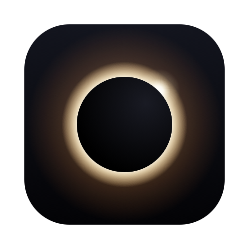

<p align="center"></p>

# Blackout

Black out your Mac screen while it keeps working. One hotkey, one menu bar icon, one command.

## Features

- **Blacks out the screen** - dims the built-in display to 0%
- **Menu bar icon** - shows at a glance whether blackout is on; its menu shows what the current session did and holds every setting
- **Global hotkey** - `⌃⌥⌘\` toggles from anywhere, and you can change it to any shortcut you like
- **Saved settings** - choose what a session does once; the hotkey, the menu and the command all follow it
- **External monitor aware** - a connected monitor stays lit as your working screen (dimming it too is a setting, requires m1ddc)
- **Smart audio muting** - mutes audio, but leaves it on when an external monitor is in use
- **Prevents sleep** - keeps the Mac awake, even with the lid closed (after one-time `blackout setup-lid`)
- **Locks on lid close** - closing the lid locks the screen while everything keeps running; unlocking ends blackout
- **Restores everything** - brightness, volume and sleep come back exactly as they were; audio you had muted yourself stays muted

## Requirements

- macOS 14.0 (Sonoma) or later, Apple Silicon
- Xcode Command Line Tools (`xcode-select --install`)
- Optional: [m1ddc](https://github.com/waydabber/m1ddc) for external monitor support (`brew install m1ddc`)

## Installation

```bash
git clone https://github.com/YOUR_USERNAME/blackout.git
cd blackout
make install
```

`make install` builds a release, assembles `Blackout.app` (the menu bar app and the `blackout` command together), and:

- installs it to `~/Applications/Blackout.app`
- links the command at `~/bin/blackout` (add `~/bin` to your `PATH` to use it from a terminal)
- registers a LaunchAgent so the menu bar app starts at login

Run it again after pulling changes; it replaces the previous install in place.

### Enable lid-close sleep prevention (optional, one-time)

```bash
blackout setup-lid
```

macOS puts the Mac to sleep when the lid closes, even with `caffeinate` running — only `sudo pmset -a disablesleep` can override it, and that needs root. This one-time setup asks for your password and writes `/etc/sudoers.d/blackout`, allowing exactly two commands to run without a password:

```
pmset -a disablesleep 1
pmset -a disablesleep 0
```

Nothing else is granted. After setup, every blackout session disables lid-close sleep and restores it when it ends. Without setup, blackout still works; the menu and `blackout status` say the lid setup is missing.

> **Warning:** while blackout is active, closing the lid keeps the Mac fully awake — including in a backpack. Watch for heat and battery drain, and turn blackout off before packing it away.

## The menu bar icon

An open ring means blackout is off; a solid disc with an arc of light (an eclipse) means it is on. Click it for the menu:

```
Blackout is on · since 14:36
Turn Off                                  ⌃⌥⌘\
──────────────────────────────────────────
This session
  Built-in display dimmed (was 62%)
  External display left on
  Audio left on (external display connected)
  Awake with the lid closed
  Won't lock while the external display is on
──────────────────────────────────────────
Settings (apply the next time Blackout turns on)
  Mute audio                              ▸
✓ Keep awake with the lid closed
✓ Lock when the lid closes
  Dim the external display too
✓ Show notifications
  Change Hotkey (⌃⌥⌘\)…
──────────────────────────────────────────
Open Log
Quit Blackout
```

- **This session** says what blackout did when it turned on, and why. The lid-lock line follows the displays connected right now, because that decision is made at the moment the lid closes.
- **Settings** are saved and apply the next time blackout turns on. They are the same settings `blackout config` shows.
- A warning line appears when a setting is on but cannot work (for example the lid setup has not been run).
- **Change Hotkey** opens a small window: press the shortcut you want.
- **Quit Blackout** also stops the hotkey until the next login.

## Settings

| Setting | `blackout config` key | Values | Default |
|---------|----------------------|--------|---------|
| Mute audio | `mute` | `auto` (only without an external display), `always`, `never` | `auto` |
| Dim the external display too | `dim-external` | `on`, `off` | `off` |
| Keep awake with the lid closed | `lid` | `on`, `off` | `on` |
| Lock when the lid closes | `lock` | `on`, `off` | `on` |
| Show notifications | `notifications` | `on`, `off` | `on` |

Change them in the menu, or from a terminal:

```bash
blackout config                 # show the settings
blackout config mute never      # change one
```

They live in `~/.blackout/config.json`. A setting changed while blackout is on takes effect the next time it turns on.

### Changing the hotkey

The shortcut is `⌃⌥⌘\` (Control + Option + Command + Backslash) until you change it. To pick your own, choose **Change Hotkey** in the menu, or run:

```bash
blackout hotkey            # opens the same window
blackout hotkey default    # back to ⌃⌥⌘\
```

Press the shortcut you want in the window that opens. It needs at least one of ⌘, ⌃ or ⌥, so it cannot swallow ordinary typing. The change takes effect at once and is saved with your settings. Esc cancels, and the window closes by itself after 30 seconds, because the hotkey is switched off while it is open.

## Command line

```bash
blackout            # toggle
blackout on         # turn on (does nothing if already on)
blackout off        # turn off (does nothing if already off)
blackout status     # what is on, the settings, the setup
```

| Command | Description |
|---------|-------------|
| `blackout`, `blackout toggle` | Toggle blackout |
| `blackout on` / `blackout off` | Turn it on or off explicitly; safe to repeat, so good for scripts |
| `blackout status` | Session details, settings, setup checks, menu bar app status and recent log |
| `blackout config [<key> <value>]` | Show the saved settings, or change one |
| `blackout hotkey [default]` | Pick a new global shortcut, or go back to the default |
| `blackout setup-lid` | One-time setup for lid-close sleep prevention |
| `blackout install` / `blackout uninstall` | Register or remove the menu bar app (use `make install`) |
| `blackout help` | Show help |

Options override the saved settings for one run:

| Option | Description |
|--------|-------------|
| `-e`, `--dim-external` / `--no-dim-external` | Dim external monitors too, or leave them on |
| `--mute` / `-m`, `--no-mute` | Mute audio, or leave it on |
| `--lid` / `-l`, `--no-lid` | Keep awake with the lid closed, or not |
| `--lock` / `-k`, `--no-lock` | Lock the screen when the lid closes, or not |

An argument blackout does not recognize is an error; it never falls through to a toggle. The older spellings `--install`, `--uninstall`, `--status` and `--setup-lid` still work.

### What happens when blackout turns on

1. Your current brightness and volume are saved
2. The built-in display dims to 0%
3. External monitors stay untouched — they remain your working screen (unless "Dim the external display too" is on; requires m1ddc)
4. Audio is muted (left on when an external monitor is in use, unless set to always or never). If you had already muted it yourself, blackout leaves it alone and does not un-mute it afterwards.
5. `caffeinate` prevents idle sleep
6. Lid-close sleep is disabled (if `blackout setup-lid` was run; left alone if sleep was already disabled system-wide)
7. Closing the lid locks the screen immediately — the Mac keeps running, but nobody can open the lid into your session. The decision is made at the moment you close the lid: if an external display is connected and left undimmed, the lock is skipped so docked use keeps working (and the internal screen is re-dimmed when the lid reopens); otherwise it locks, even if the external was unplugged mid-session. Opening the lid onto a lock screen restores brightness so it is readable, and unlocking ends blackout entirely — always, regardless of connected displays.
8. A notification confirms it (unless notifications are off)

A monitor counts as "in use" when macOS lists it and m1ddc can read it. One that is switched off, or a virtual display, is treated as absent, so audio is muted rather than left playing on a dark machine.

### What happens when it turns off

1. Original brightness is restored
2. External monitor brightness is restored (if it was dimmed)
3. Audio is unmuted and volume restored (if it was muted)
4. Sleep prevention is removed, lid-close sleep re-enabled, and the lid watcher stopped

## How It Works

```
   your hotkey         menu bar icon         $ blackout
        │                    │                    │
        └────────┬───────────┘                    │
                 ▼                                │
      Blackout.app (blackout-menu)                │
      starts at login, runs the CLI ──────────────┤
                                                  ▼
                                     blackout CLI  →  BlackoutCore
                                                  │
                    ┌─────────────────────────────┴──────────────┐
                    ▼                                            ▼
         OFF → turn on:                               ON → turn off:
         • read ~/.blackout/config.json               • restore everything
         • save brightness and volume                   named in the state file
           to ~/.blackout.state                       • stop caffeinate and
         • start caffeinate -d                          the lid watcher
         • disable lid sleep*                         • re-enable lid sleep
         • start the lid watcher
         • dim, mute

         *after one-time 'blackout setup-lid'
```

The menu bar app holds no state of its own: the icon and the menu are drawn from the state and settings files, so they always agree with what the hotkey, the command or the lid watcher did. Only one start or stop runs at a time; a second one fired at the same moment waits and then finds nothing left to do.

## File Locations

| File | Purpose |
|------|---------|
| `~/Applications/Blackout.app` | The menu bar app and the `blackout` command |
| `~/bin/blackout` | Symlink to the command inside the app |
| `~/.blackout/config.json` | Saved settings |
| `~/.blackout.state` | The running session: what to restore, and what it did |
| `~/.blackout/daemon.log` | Menu bar app log, including how long each toggle took |
| `~/.blackout/daemon.pid` | Menu bar app process ID |
| `~/.blackout/lock` | Held while a session starts or ends |
| `~/Library/LaunchAgents/com.blackout.daemon.plist` | LaunchAgent that starts the app at login |
| `/etc/sudoers.d/blackout` | Passwordless rule for `pmset disablesleep` (from `blackout setup-lid`) |

## Troubleshooting

### The icon is missing or the hotkey does not work

1. Check the app:
   ```bash
   blackout status
   ```

2. If it is not running, reinstall from the repository:
   ```bash
   make install
   ```

3. On macOS 26 and later, check System Settings → Menu Bar: the Blackout item can be hidden there.

4. Look at the log: `~/.blackout/daemon.log` (also under **Open Log** in the menu).

### External monitor not dimming

By default a connected monitor is deliberately left on — it's assumed to be
your working screen (e.g. lid closed on a dock). Turn on "Dim the external
display too" (or pass `--dim-external`) to dim it. If that still does nothing:

1. Install m1ddc:
   ```bash
   brew install m1ddc
   ```

2. Verify your monitor supports DDC/CI (most do, but some gaming monitors disable it)

3. Test m1ddc directly:
   ```bash
   m1ddc display list
   m1ddc set luminance 50
   ```

### Screen stays black after a crash

Just run `blackout` again. If a saved session exists — even one whose
caffeinate process died in a crash or reboot — blackout restores from it
instead of re-enabling. If the state file itself was lost:

```bash
# Restore brightness manually
brightness 1.0

# Or use the keyboard: press F2 (or fn+F2) repeatedly
```

### Mac won't sleep after a crash

If blackout crashed while active with lid-sleep prevention on, sleep stays disabled (the setting survives reboots). Check and reset with:

```bash
pmset -g | grep SleepDisabled   # 1 = sleep disabled
sudo pmset -a disablesleep 0
```

### The menu says the lid setup is missing

Run the one-time setup:

```bash
blackout setup-lid
```

### A second `blackout` process is running

That is the lid watcher (`blackout --lid-watch`). It exists only while blackout
is active and exits when you turn blackout off — or when you unlock after a
lid close, which ends the session. Turn it off with the "Lock when the lid
closes" setting.

### The lock screen is black after opening the lid

Blackout sets brightness to 0%, and it restores it when the lid opens. If that
did not happen, press the brightness-up key — it works at the lock screen — and
report it: the restore is the part of this feature most likely to be defeated by
a macOS change.

### Closing the lid does not lock the screen

If an external display was connected and left undimmed at that moment, the skip
is deliberate — the external is treated as your working screen (the menu says
"Won't lock while the external display is on"), and `blackout -e` locks
instead. Otherwise look at "This session" in the menu or `blackout status`:
"Cannot lock when the lid closes (macOS lock call missing)" means macOS no
longer exposes `SACLockScreenImmediate`, and locking would need another
mechanism.

### Locking manually leaves the screen dark

Locking with ⌃⌘Q (or the screensaver) while blackout is on does not restore
brightness — blackout would otherwise sit lit at the lock screen indefinitely,
since it prevents display sleep. Press the brightness-up key at the lock
screen, or unlock by Touch ID; unlocking ends blackout either way.

## Limitations

Cannot prevent sleep from:
- Closing laptop lid *before* `blackout setup-lid` has been run
- Apple menu → Sleep (greyed out while lid sleep is disabled)
- Low battery
- Thermal emergency

## Development

```bash
make test       # run the test suite (swift run blackout-tests)
make bundle     # build .build/Blackout.app without installing it
make install    # build and install
make icon       # redraw the app icon after changing scripts/make-icon.swift
```

Code is organized as a `BlackoutCore` library holding all the logic, with two
thin executables on top: `blackout` (the CLI) and `blackout-menu` (the menu
bar app). Session logic talks to the Mac through one protocol,
`SystemControls`, so the tests run it against a recording fake instead of a
real display, speaker and lid.

Tests use [Swift Testing](https://developer.apple.com/documentation/testing) via the
dedicated `blackout-tests` runner, because `swift test` cannot execute Swift
Testing bundles with Command Line Tools alone (no full Xcode required this way).

## Uninstall

```bash
blackout uninstall    # removes the app, the command and the LaunchAgent; keeps your settings
./uninstall.sh        # removes everything, including settings and the sudo rule
```

Both turn blackout off first if it is on.

## License

MIT
